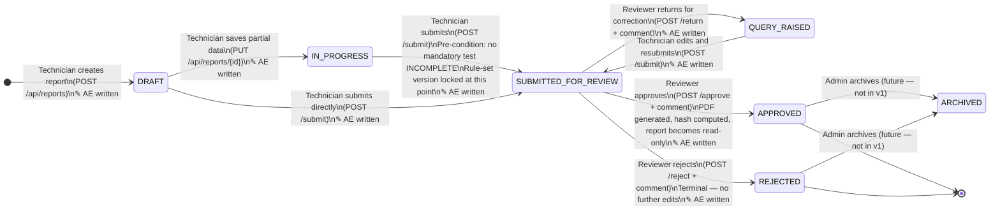

# Phase 0 — Domain & Architecture Preparation
## NAWI Test Report Management System

> **Status:** Complete — no code exists yet. This document is the shared mental model
> for the whole team before Phase 1 begins.
>
> **Baseline docs consumed:** `01_PROJECT_OVERVIEW.md`, `02_GLOSSARY.md`,
> `03_USER_ROLES_AND_PERMISSIONS.md`, `04_WORKFLOW_AND_STATUS_LIFECYCLE.md`,
> `06_ARCHITECTURE.md`

---

## 1. One-Paragraph System Summary

The NAWI Test Report Management System is a **local-first web application** that
digitises the end-to-end process of creating, calculating, reviewing, approving, and
archiving test reports for Non-Automatic Weighing Instruments (NAWIs) — electronic
scales, platform scales, and weighbridges — in accordance with OIML Recommendation R-76.
Today this process is entirely manual (paper forms, spreadsheets, Word documents, email
handoffs), which introduces calculation errors, format inconsistencies, missing test
coverage, and no auditable history. Version 1 replaces the manual process with a
structured wizard that guides a lab technician through data entry, automatically
calculates observed error against the maximum permissible error (MPE) for the instrument's
accuracy class and load range, enforces a formal review-and-approval workflow with a full
audit trail, and produces a tamper-evident, hashed PDF report — all running on a single
local machine with no cloud dependency.

---

## 2. Glossary Review

All terms sourced from `02_GLOSSARY.md`. Terms marked ⚠️ contain thresholds or criteria
that must be validated against the official OIML R-76 edition before the system is used
in any real legal-metrology context.

| Term | Plain-English Definition | Domain Validation Required? |
|---|---|---|
| **NAWI** | A weighing instrument that needs a human operator during use — e.g. a shop scale or platform scale — as opposed to a fully automatic system. | No |
| **OIML** | The international standards body (Organisation Internationale de Métrologie Légale) that publishes technical requirements for measuring instruments used in trade and law. | No |
| **OIML R-76** | The specific OIML document that defines every test, threshold, and formula this system implements. All MPE values and test criteria in the rule-set are drawn from R-76. | ⚠️ All thresholds require validation against the official edition in use |
| **Legal Metrology** | The regulated branch of measurement science covering instruments used in commerce or law, to ensure they are fair and accurate. | No |
| **Model Approval / Type Evaluation** | The formal certification process by which a model of weighing instrument is declared fit for legal/commercial use, based on passing a defined battery of tests. | No |
| **Accuracy Class** | A category (Class II, III, or IIII) that determines which MPE table applies to an instrument. | ⚠️ Class boundaries and MPE tables require validation against official R-76 edition |
| **e (Verification Scale Interval)** | The "legal" resolution unit for compliance checks — the smallest division the instrument is legally allowed to use for trade purposes. | ⚠️ Exact role in MPE calculation needs validation |
| **d (Actual Scale Interval)** | The actual smallest increment the instrument's display shows; may be finer than `e`. | No |
| **n (Number of Verification Intervals)** | Max capacity ÷ e; determines which MPE tier applies within the accuracy-class table. | ⚠️ Exact tier boundaries require validation |
| **MPE (Maximum Permissible Error)** | The largest error the instrument is allowed to show at a given load, per its accuracy class and `n`. This is the pass/fail threshold. | ⚠️ Numeric values require validation against official R-76 edition |
| **Observed Error** | The raw difference between the instrument's displayed reading and the true/reference value during a test. | No |
| **Corrected Error** | Observed error adjusted for any known zero error or systematic offset. | ⚠️ Correction formula requires domain validation |
| **Eccentricity Test** | A test that places a load at each corner/position of the weighing platform to verify the reading does not vary beyond the permitted error based on position. | No |
| **Repeatability Test** | A test that applies the same load multiple times to check the instrument gives consistent (reproducible) readings. | No |
| **Discrimination Test** | A test that verifies the instrument can detect a small additional load equal to its stated resolution (`d`). | No |
| **Verification / Stamping** | The legal act of certifying and sealing an instrument for trade use, following a successful evaluation. | No |
| **Rule-Set** | A versioned JSON configuration file holding all MPE tables and test criteria. The calculation engine reads from this file — thresholds are never hardcoded. | ⚠️ All values inside require validation |
| **Draft / Submitted / Approved / Rejected** | The four primary statuses a report moves through in the review workflow. See Section 4 for the full state machine. | No |
| **Repository (data)** | A backend abstraction layer (interface + implementation) that reads/writes stored data independently of the underlying storage technology. | No |
| **Report Hash** | A SHA-256 fingerprint computed from an approved report's content to detect tampering. **This is NOT a legally valid digital signature.** | No — but its limitations must be disclosed everywhere it appears |

---

## 3. Role Matrix

Permission enforcement is **always in the backend**. UI hiding is a convenience, not a
security control. A technician calling `POST /approve` directly must be rejected by the
server regardless of what the frontend shows.

| Role | Can Do | Cannot Do | Backend Enforcement? |
|---|---|---|---|
| **TECHNICIAN** | Create a report; enter instrument/lab/environment details; enter test observations; upload attachments; save as draft at any point; view live calculations as they type; submit the report for review; respond to reviewer queries and resubmit; perform retests | Approve or reject a report; edit an approved (read-only) report; edit rule-sets | ✅ `require_role(TECHNICIAN)` on create/edit/submit endpoints; service layer checks report ownership |
| **REVIEWER** | View submitted reports; review instrument details, observations, and calculations; check pass/fail results; add comments; return a report for correction (with comment); approve a report; trigger/authorise final report generation | Create reports on a technician's behalf (out of scope for v1); edit rule-sets | ✅ `require_role(REVIEWER, ADMIN)` on return/approve/reject endpoints |
| **ADMIN** | Everything a Technician and Reviewer can do, plus: manage users and their roles; configure laboratory details; configure and version OIML rule-sets; view all reports lab-wide; view dashboard statistics; review the audit log; manage report templates and rule-set versions | Bypass the review workflow — an admin approving a report still goes through the same status transition and audit event as a reviewer | ✅ `require_role(ADMIN)` on rule management and user management endpoints |
| **VIEWER** | View approved reports; search report history; download approved reports | Edit anything; approve/reject/comment; see draft or in-review reports (unless explicitly extended later) | ✅ Service layer filters list/get results to APPROVED status only for VIEWER token |

---

## 4. Status Machine

The diagram below is the authoritative status lifecycle. Every arrow is a transition;
the label shows **who** triggers it and whether it writes an **audit event (AE)**.



### Transition rules (prose)

| From | To | Who | Pre-condition |
|---|---|---|---|
| DRAFT / IN_PROGRESS / QUERY_RAISED | SUBMITTED_FOR_REVIEW | TECHNICIAN (or ADMIN) | No mandatory test INCOMPLETE; rule-set version locked |
| SUBMITTED_FOR_REVIEW | QUERY_RAISED | REVIEWER or ADMIN | Must include a comment |
| SUBMITTED_FOR_REVIEW | APPROVED | REVIEWER or ADMIN | Must include a comment; triggers PDF + hash generation |
| SUBMITTED_FOR_REVIEW | REJECTED | REVIEWER or ADMIN | Must include a comment |
| APPROVED | *(any edit)* | *(any)* | **Rejected by service layer** — approved reports are immutable |

---

## 5. Architecture Layers

### Diagram

```
┌──────────────────────────────────────────────────────┐
│                  BROWSER (React / TS / Vite)          │
│                                                        │
│  Pages: Login · Dashboard · Repository               │
│         ReviewPage · RuleAdmin                        │
│                                                        │
│  Wizard: Step1Metadata → Step2Instrument →            │
│          Step3Environment → Step4TestSelection →      │
│          Step5TestDataEntry → Step6Attachments →      │
│          Step7ReviewAndSubmit                         │
│                                                        │
│  api/           Typed fetch wrappers (one file per   │
│                 resource — auth, reports, calc, etc.) │
│  types/         TS interfaces (mirror backend schemas)│
└─────────────────────┬────────────────────────────────┘
                       │  REST / JSON over HTTP
                       │  (localhost:8000)
┌──────────────────────▼────────────────────────────────┐
│              BACKEND (FastAPI / Python)                │
│                                                        │
│  app/api/   ROUTERS                                   │
│    auth · reports · calculations · rules              │
│    attachments · audit · dashboard                    │
│             │                                          │
│             ▼                                          │
│  app/services/   SERVICES                             │
│    ReportService · CalculationEngine                  │
│    ValidationEngine · RuleEngine                      │
│    ReportGenerationService · AuditService             │
│    SearchService · AuthService                        │
│             │                                          │
│             ▼                                          │
│  app/repositories/   REPOSITORY INTERFACES            │
│    ReportRepository · UserRepository                  │
│    RuleRepository · AttachmentRepository              │
│    AuditRepository                                    │
│             │                                          │
│             ▼                                          │
│  LOCAL STORAGE ADAPTER (JSON files on disk)           │
│    JsonReportRepository · JsonUserRepository          │
│    JsonRuleRepository · JsonAuditRepository           │
└─────────────────────┬────────────────────────────────┘
                       │
               storage/ (local filesystem)
                 reports/  attachments/
                 generated-reports/  rules/
                 users/  audit/  templates/
```

### Four Non-Negotiable Layering Rules

> These rules are not style preferences — violating any one of them breaks the system's
> legal-metrology correctness guarantees or blocks the future database migration.

| # | Rule | Why it matters |
|---|---|---|
| **L1** | **Frontend never touches storage.** It only calls REST endpoints. It has no idea whether data lives in JSON files, SQLite, or Postgres. | Swapping the storage layer later requires zero frontend changes. |
| **L2** | **Services never touch the filesystem directly.** Only repository implementations do. Services depend on repository *interfaces*, not concrete file-reading code. | A future `PostgresReportRepository` slots in without touching any service. |
| **L3** | **The backend is the source of truth** for all calculations, validation, pass/fail determination, report status, user permissions, report finalization, and hash generation. The frontend may show a live preview of a calculation, but that preview is computed by calling the backend's calculation endpoints — never computed in a React component. | Keeps legally sensitive logic in one tested, auditable place. |
| **L4** | **The Calculation Engine is pure.** Its functions take data in, return a result, perform no I/O. | The most legally sensitive part of the system must be the easiest to unit test in isolation — no server, no database, no file system needed. |

---

## 6. Open Questions (Requires Domain Validation)

The following items are explicitly flagged as uncertain in the baseline documentation.
They must be resolved by a qualified legal-metrology professional before the system is
used in any real certification context. They are **not** resolved here.

| # | Item | Source doc | Why it's flagged |
|---|---|---|---|
| OQ-01 | The MPE table values for each accuracy class (Class II, III, IIII) — the `mpeInE` values per interval range in the rule-set JSON | `11_RULE_ENGINE_SPEC.md` | Marked *"Prototype value — requires domain validation against official OIML R-76 edition"* |
| OQ-02 | The exact interval boundaries for MPE tier selection (e.g., 0–5000 intervals = 0.5e; 5001–20000 = 1.0e) for Class III | `11_RULE_ENGINE_SPEC.md` | Same as above; these are placeholder values for the prototype |
| OQ-03 | The correction formula for corrected error (observedError − zeroError) — whether this is the correct and complete formula per R-76 | `11_RULE_ENGINE_SPEC.md` §"formulaId: OBSERVED_ERROR_V1" | Labelled as a prototype formula identifier; official formula requires expert confirmation |
| OQ-04 | Whether `n` must be exactly `maxCapacity / e` or whether there is a rounding/floor/ceiling rule per R-76 for the interval count | `13_VALIDATION_RULES.md` §B | Validation rule says *"where applicable"* — exact rule not confirmed |
| OQ-05 | The applicability conditions for each test — specifically, under what instrument configurations each of the four tests is mandatory vs optional | `12_TEST_MODULES.md` §E | Only four of ~15 tests are implemented; applicability logic for even the four implemented tests requires expert sign-off |
| OQ-06 | Whether a report with at least one FAIL result can still be submitted and approved (with the reviewer explicitly noting it), or whether FAIL blocks submission entirely | `04_WORKFLOW_AND_STATUS_LIFECYCLE.md` | The workflow allows submission of reports where tests may have failed; the review step exists to handle this — but the exact policy needs legal-metrology confirmation |
| OQ-07 | The legal standing of the prototype integrity hash — specifically, which digital-signature standard would be required for a legally binding approved report in the target jurisdiction | `14_REPORT_GENERATION_AND_AUDIT.md` §"Integrity, not legal signature" | Explicitly flagged: *"This hash is not a legally valid digital signature"* |
| OQ-08 | The mandatory disclaimer text — whether the exact wording in `11_RULE_ENGINE_SPEC.md §6` is sufficient or whether jurisdiction-specific language is required | `11_RULE_ENGINE_SPEC.md §6` | Flagged as requiring legal-metrology review |
| OQ-09 | The 13+ planned-but-unimplemented OIML R-76 tests (creep, zero return, temperature effect, etc.) — their exact inputs, formulas, and acceptance criteria | `12_TEST_MODULES.md §E` | Explicitly deferred; must not be guessed or prototyped without expert input |

---

## 7. Out-of-Scope List (Version 1 Deliberate Boundaries)

The following are **not oversights** — they are documented, deliberate decisions about
what version 1 does not attempt to build. Any attempt to implement these during Phases
1–10 is out of bounds.

| # | Out-of-scope item | Where documented |
|---|---|---|
| OS-01 | No external database (PostgreSQL, MongoDB, Firebase, or any cloud DB). All persistence in v1 is backend-managed local JSON files. | `01_PROJECT_OVERVIEW.md`, `08_LOCAL_STORAGE_DESIGN.md` |
| OS-02 | No real digital signature or PKI integration. The prototype uses a SHA-256 content hash as an integrity indicator only. | `01_PROJECT_OVERVIEW.md`, `14_REPORT_GENERATION_AND_AUDIT.md` |
| OS-03 | No multi-laboratory synchronisation or central government integration. The system runs on one local machine for one lab. | `01_PROJECT_OVERVIEW.md` |
| OS-04 | No hardware integration with physical weighing instruments. All readings are entered manually by the technician. | `01_PROJECT_OVERVIEW.md` |
| OS-05 | Only 4 of the ~15+ OIML R-76 test types are fully implemented (Weighing Performance, Eccentricity, Repeatability, Discrimination). The remaining tests exist as clearly labelled placeholders with `status: "PLANNED"`. | `01_PROJECT_OVERVIEW.md`, `12_TEST_MODULES.md §E` |
| OS-06 | No authentication provider (Auth0, Firebase Auth, or similar). Login is simulated against a local JSON users file. | `05_TECH_STACK.md` |
| OS-07 | No message queue or background job system. Report generation runs synchronously. | `05_TECH_STACK.md` |
| OS-08 | No DOCX or editable-HTML report output in v1. Only PDF is required. DOCX is a stretch goal, and the `reportgen/` abstraction is designed to accommodate it later. | `14_REPORT_GENERATION_AND_AUDIT.md` |
| OS-09 | No real user management UI in v1. Four prototype users (one per role) are seeded directly into the users JSON file. | `03_USER_ROLES_AND_PERMISSIONS.md` (implied), `17_DEMO_DATA.md` |
| OS-10 | No ARCHIVED status implementation. The status diagram shows it as a future state from APPROVED or REJECTED — it is not built in v1. | `04_WORKFLOW_AND_STATUS_LIFECYCLE.md` |

---

## Verification Gate — Phase 0 Complete When:

- [ ] Every team member (and a first-time reader of this document) can describe the
      workflow, the four roles, and the storage approach without asking a follow-up question.
- [ ] Every open question in Section 6 has been reviewed by at least one person who can
      either confirm it is acceptable for a prototype or escalate it to a domain expert.
- [ ] The out-of-scope list in Section 7 has been acknowledged by the product owner.
- [ ] No code has been written yet.

---

*Document produced as Phase 0 output. Source: baseline docs 01–04 and 06 in `DOCS/`.*
*No thresholds, formulas, or assumptions have been invented — all content is drawn
directly from the baseline documentation set.*
