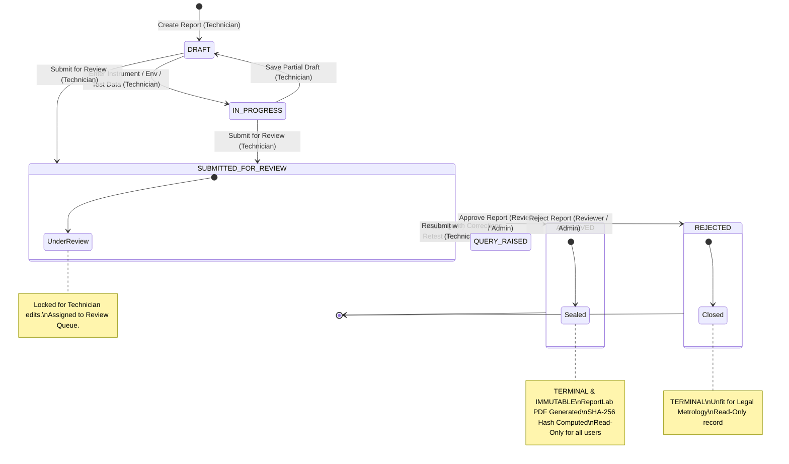

# Report Status Lifecycle & State Machine — NAWI System

> **Project ID:** SIH26035 — Smart India Hackathon 2026  
> **Standard:** OIML R-76  
> **Phase:** Phase 0 — Status Lifecycle Specification

---

## 1. Status Lifecycle Diagram

The lifecycle of an OIML R-76 test report follows a strict finite state machine. Transitions are uni-directional with the exception of the query-and-resubmission review loop between `SUBMITTED_FOR_REVIEW` and `QUERY_RAISED`.

> **Key Rule on Resubmission:** Resubmission is strictly modeled as the state transition `QUERY_RAISED` $\rightarrow$ `SUBMITTED_FOR_REVIEW` with audit action `RESUBMIT`. There is **no** separate `RESUBMITTED` status value in the data model.

---

## 2. Status Transition Matrix

| From Status | To Status | Triggering Role | API Endpoint & Action | Preconditions & Validation Rules | Audit Action | Post-Conditions & Side Effects |
|---|---|---|---|---|:---:|---|
| *None* | `DRAFT` | `TECHNICIAN`, `ADMIN` | `POST /api/reports` | Valid initial payload (instrument model, manufacturer, lab). | `CREATE` | Report ID generated (`NAWI-YYYY-XXXX`). Initial version set to 1. |
| `DRAFT` | `IN_PROGRESS` | `TECHNICIAN`, `ADMIN` | `PUT /api/reports/{id}` | User must be owner or admin. Field validation per step. | `UPDATE` | Test observations and environmental conditions saved to disk. |
| `IN_PROGRESS` | `DRAFT` | `TECHNICIAN`, `ADMIN` | `PUT /api/reports/{id}` | Optional manual revert or draft checkpoint. | `UPDATE` | Draft status preserved for editing. |
| `DRAFT` / `IN_PROGRESS` | `SUBMITTED_FOR_REVIEW` | `TECHNICIAN`, `ADMIN` | `POST /api/reports/{id}/submit` | 1. Zero validation errors. 2. All applicable tests completed with `PASS` or `FAIL`. 3. No applicable test is `INCOMPLETE`. | `SUBMIT` | 1. Current active rule-set version locked to report. 2. Report locked from technician modifications. 3. Placed into Reviewer Queue. |
| `SUBMITTED_FOR_REVIEW` | `QUERY_RAISED` | `REVIEWER`, `ADMIN` | `POST /api/reports/{id}/return` | Reviewer comment/query text is mandatory (minimum 5 characters). | `RETURN` | 1. Reviewer comments saved to `review.reviewerComments`. 2. Report reopened for Technician correction/retest. |
| `QUERY_RAISED` | `SUBMITTED_FOR_REVIEW` | `TECHNICIAN`, `ADMIN` | `POST /api/reports/{id}/submit` | Technician must address the reviewer query. Same completion rules apply. | `RESUBMIT` | 1. Report version incremented. 2. Returned to review queue with updated observations. |
| `SUBMITTED_FOR_REVIEW` | `APPROVED` | `REVIEWER`, `ADMIN` | `POST /api/reports/{id}/approve` | 1. Caller cannot be same user as creator unless Admin. 2. All applicable tests have status `PASS` (or `NOT_APPLICABLE`). | `APPROVE` | 1. `finalResult` set to `PASS`. 2. Report marked permanently **IMMUTABLE**. 3. PDF report automatically generated via ReportLab. 4. SHA-256 integrity hash computed and stored. |
| `SUBMITTED_FOR_REVIEW` | `REJECTED` | `REVIEWER`, `ADMIN` | `POST /api/reports/{id}/reject` | Mandatory rejection justification comment provided. One or more critical tests failed MPE. | `REJECT` | 1. `finalResult` set to `FAIL`. 2. Report permanently locked from further editing or resubmission. |

---

## 3. Immutability & Audit Guarantee

1. **APPROVED Reports are Immutable:**
   Once a report enters `APPROVED`, any subsequent `PUT`, `POST` (update/submit), or `DELETE` request sent to `/api/reports/{id}/*` is rejected by the backend with HTTP `422 Unprocessable Entity` or `403 Forbidden`. The stored JSON and generated PDF cannot be modified through application channels.
2. **Deterministic Audit Log:**
   Every single transition without exception appends an immutable event record to `backend/storage/audit/audit_log.json` containing:
   - `eventId` (UUID)
   - `reportId`
   - `actorId` and `actorRole`
   - `action` (`CREATE`, `UPDATE`, `SUBMIT`, `RETURN`, `RESUBMIT`, `APPROVE`, `REJECT`)
   - `fromStatus` and `toStatus`
   - `comment` (if applicable)
   - `ruleSetVersion`
   - `timestamp` (UTC ISO 8601)
